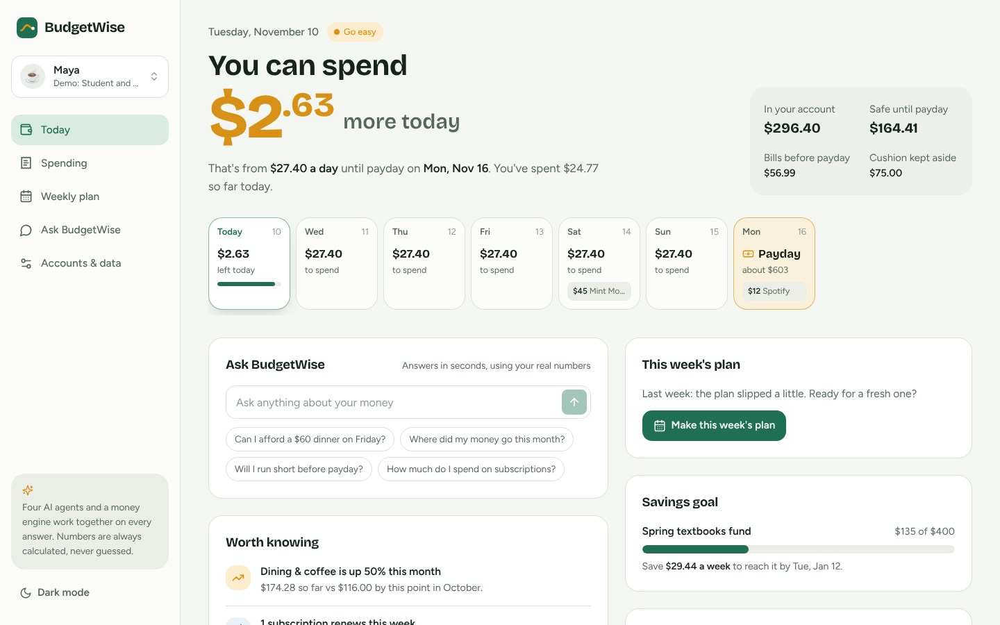
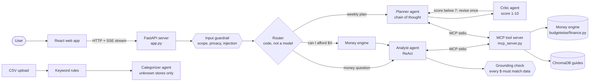

# BudgetWise AI (Team 3, CEN 4930 M4)

**Problem:** People with irregular income (students, part-time and gig workers, freelancers) can see their balance, but they can't tell how much they can safely spend today, whether they'll run short before payday, or what to change this week.

**What BudgetWise does:** It reads your bank transactions and answers those questions in seconds. A team of AI agents explains the numbers and builds a weekly plan, and Python calculates every dollar.



## What you can do
- **See what's safe to spend today.** BudgetWise subtracts bills due before payday, money held for bills right after payday, and your cushion. The "runway" shows every day until payday, with bills and paychecks marked.
- **Ask anything.** For example: "Can I afford a $60 dinner on Friday?", "Where did my money go this month?", or "Will I run short before payday?". Each answer shows which agent did what and confirms that every number was checked.
- **Get a weekly plan.** It sets a daily limit, a cap on one category and an amount to save. The Critic agent reviews the plan, and nothing is saved until you click **Start this plan**. Next week, BudgetWise checks how it went.
- **Upload your own bank CSV.** It reads exports from Chase, Bank of America, Capital One, Wells Fargo and most others. Transactions are sorted automatically, and recurring bills and paydays are detected. Your file stays on your computer.
- **Try demo people.** **Maya** (student barista), **Jordan** (rideshare driver) and **Priya** (freelance designer) each have a different kind of irregular income.

## How it works



| Agent | Job | Pattern (chapter) |
|---|---|---|
| **Analyst** | Answers money questions using the facts and MCP tools | ReAct (Ch 5) |
| **Planner** | Chooses this week's strategy; the `build_weekly_plan` tool does the math | Chain of thought (Ch 5) |
| **Critic** | Scores each plan for grounding, realism and clear actions, and sends weak plans back once | Critic agent (Ch 7) |
| **Categorizer** | Labels bank descriptions that no keyword rule matches, in one batch | Typed JSON output (Ch 2) |

### How BudgetWise follows the course

| Course idea | Where it is in BudgetWise |
|---|---|
| Tools in an MCP server (Ch 3) | `mcp_server.py`: 6 tools, started once at app startup over stdio |
| Multi-agent orchestration, deterministic decision points (Ch 4) | `budgetwise/agents.py`: the router is code, so it adds no model call and always behaves the same way |
| Guardrails and the cost ladder (Ch 4) | `guardrails.py`: free checks first (scope, privacy, prompt injection, grounding). The Critic is the only LLM check |
| ReAct and chain of thought (Ch 5) | Analyst and Planner instructions |
| RAG and memory (Ch 6) | ChromaDB guides (`knowledge/`), short-term chat memory, saved weekly plans |
| Grounding and critic evaluation (Ch 7) | Every dollar amount is verified, and plans get a 1-10 critic score |
| Hosting agents behind an API, streamed with SSE (Ch 8) | `app.py`, following the `chapter_08/01z` pattern |
| Human in the loop, allowlists, secrets (Ch 8) | Plans are saved only when you click Start. Each agent sees only its own tools. The API key stays on the server |

## Setup and run (Windows PowerShell)
1. Install **Python 3.11 or newer**. If `chromadb` won't install on the newest Python, use Python 3.12.
2. Download the code and open the folder:
   ```powershell
   git clone https://github.com/erFig/TeamProject3_M4.git
   cd TeamProject3_M4
   ```
3. Create a virtual environment and install the packages:
   ```powershell
   python -m venv venv
   venv\Scripts\activate
   python -m pip install -r requirements.txt
   ```
4. Copy `.env.example` to `.env` and paste your NRP token. Never commit `.env`.
5. Start the app and open **http://localhost:8000**:
   ```powershell
   uvicorn app:app --port 8000
   ```
   On Windows, don't add `--reload`: it switches Python to an event loop that can't start the MCP tool server.

The first start downloads ChromaDB's small embedding model (about 80 MB) once. You don't need Node: the built web app is already in `frontend/dist`.

**Other ways to run it**
- Terminal version: `python agent.py "Can I afford a $60 dinner on Friday?"`, `python agent.py --plan`, or `python agent.py` for chat mode.
- Editing the UI (needs Node 18+): run `cd frontend`, `npm install`, then `npm run dev` (opens on :5173 and talks to the Python server on :8000). Run `npm run build` when you're done.
- Regenerating the demo data: `python scripts/make_demo_data.py`.

## Project structure
```
app.py                  FastAPI server: REST + streamed chat/plan endpoints, serves the React app
agent.py                Same agent team in the terminal
mcp_server.py           MCP tool server (thin wrappers around the money engine)
guardrails.py           Input, grounding and sanitizing checks (no model needed)
budgetwise/
  finance.py            Money engine: safe-to-spend, bills, paydays, forecast, insights, plans
  agents.py             Router, Analyst, Planner, Critic, Categorizer, streaming
  importer.py           Reads any bank's CSV export
  categories.py         Categories and keyword rules
  knowledge.py          ChromaDB search over knowledge/*.md
  store.py              Local JSON storage in data/workspace/ (git-ignored)
frontend/               React + Vite + Tailwind + Recharts (built copy in frontend/dist)
data/personas/          Demo people (fake data, dates relative to today)
data/samples/           Sample bank CSV for trying the upload
knowledge/              Budgeting guides (Penn State Extension, CFPB)
tests/                  Unit tests (no model calls)
docs/m3/                M3 architecture and evaluation, kept for reference
```

## Tests
- `python -m pytest` runs **35 checks with no model calls**: the money math, the CSV importer, the categorizer rules, the router, the guardrails, and the MCP server over the real protocol.

## CHANGES (since M3)
| Change | Why | Effect |
|---|---|---|
| **Web app** (React) replaces the command line: Today dashboard with payday runway, Spending, Weekly plan, Ask, Accounts | M3 could only be used from a terminal, and testers need something they can actually use | Usable by people who don't code |
| **One server that stays running**, so the MCP server and ChromaDB load once at startup | In M3 every question relaunched the tool server and reloaded the embedding model | Startup cost is paid once (about 2 s) instead of on every question |
| **Pre-computed snapshot** handed to the agents, and **routing done in code** instead of a handoff | In M3 a plan question took about 11 model calls and 22,000 tokens | Simple questions now take about 2 to 5 s with 0 or 1 tool calls. Plans take about 11 to 15 s |
| **Streaming answers** and a live agent timeline (SSE) | The M3 demo showed a long blank wait | You see progress right away |
| **Real data**: CSV import for most banks, plus automatic detection of recurring bills, paydays and income swings | M3 used one fixed sample file with a frozen date | Works on a real bank export. Demo dates now follow today |
| **Smarter safe-to-spend**: holds back money for bills due right after payday when the next paycheck won't cover them | Irregular-income users were told they had money that was really needed for rent | Jordan's demo holds $1,148 for rent that's due the day after a small payout |
| **Critic agent** (1-10 score; code approves at 7 or higher, otherwise one revision) | M3 planned this for M4 (Ch 7) | Each plan arrives with a score |
| **Categorizer agent** with keyword rules first and a cache | Ch 4 cost ladder: the cheapest check first | Most rows are sorted by rules, and only unknown store names go to the model |
| **Prompt-injection check** and sanitizing of uploaded text | Ch 8 threat model: bank descriptions are untrusted | Blocks "ignore your instructions" attempts |
| **M3 bug fixed**: a plan's category cap is never looser than last week's cap | Known limitation #1 in M3 | Covered by a unit test |
| Grounding check accepts whole-dollar rounding ("$27" for 27.40) | People talk in round numbers | Wrong cents and invented amounts are still flagged |

## Known limitations
1. **NRP response times vary.** Most answers take 2 to 5 seconds, but the same plan sometimes takes 25 seconds or more when the model is busy. After 45 seconds an agent shows the calculated numbers instead.
2. **Recurring-bill detection needs history.** It needs at least two payments on a regular schedule (weekly, every 2 weeks or monthly), so upload two or three months of transactions.
3. **One person, one computer.** Data is stored in local JSON files, with no login or bank connection (the CSV export is the bridge).
4. **The input guardrail uses keywords**, so it can block a harmless question like "sales tax" and miss reworded ones.
5. **The model's advice text can still be generic.** The numbers are verified, but the wording of a tip isn't.
