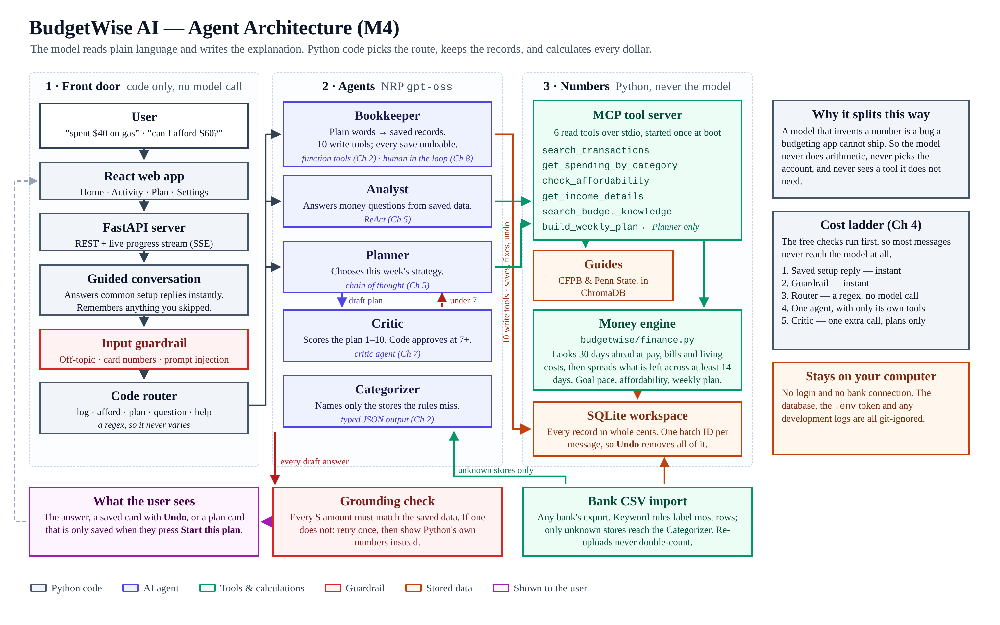

# BudgetWise M4 architecture

This document describes the current `m4-upgrade` implementation. The language model interprets requests and writes explanations, while deterministic Python code owns routing decisions, saved data, guardrails, and every money calculation.

## System diagram

*Source: [`architecture.html`](architecture.html) — open it in a browser and screenshot at 1520x950 to regenerate.*

Bookkeeper, Analyst, Planner, Critic, and Categorizer are the five agent roles. The conversation controller, router, guardrails, and money engine
are deterministic application code. This keeps common inputs fast and prevents the language model from
controlling account selection or financial arithmetic.

## Request flow

1. React calls FastAPI through REST endpoints; chat and plan progress use Server-Sent Events.
2. The conversation controller restores the current workspace and handles common setup answers instantly without a model call.
3. For a money event, deterministic quick paths collect only the missing decision: payment source, whether received money entered available money, or whether a bill was paid versus still due. The selected default can be reused for later purchases.
4. The input guardrail blocks off-topic requests, sensitive account/card numbers, and prompt-injection attempts.
5. A deterministic router selects greeting/help, logging, affordability, planning, or analysis.
6. The selected agent receives only the tools it needs. The active workspace is supplied by application context, never chosen by the model.
7. `budgetwise/finance.py` performs all arithmetic using records stored as integer cents in SQLite.
8. The grounding guardrail verifies every dollar amount before the final answer is shown. If verification fails, the app retries once and then falls back to Python-calculated facts.

## Agent responsibilities

| Agent | Responsibility | Access |
|---|---|---|
| Analyst | Answers questions about spending, income, affordability, and financial patterns | Read-only MCP tools and budgeting-guide search |
| Planner | Chooses a seven-day savings and spending strategy | `build_weekly_plan`; Python recomputes authoritative values |
| Critic | Scores plans for grounding, realism, and clear actions | Plan facts only; code makes the approve/revise decision |
| Bookkeeper | Converts natural language into spending, income, bills, pay schedules, balances, goals, fixes, and undo batches | Allowlisted SQLite write tools |
| Categorizer | Labels only CSV merchants not matched by deterministic keyword rules | Sanitized merchant descriptions in batches |

## Main modules

| Path | Role |
|---|---|
| `app.py` | FastAPI lifecycle, REST/SSE endpoints, account context, and React static serving |
| `budgetwise/conversation.py` | Persistent guided conversation state, quick replies, question progression, and loop prevention |
| `budgetwise/agents.py` | Router plus Analyst, Planner, Critic, and Categorizer orchestration |
| `budgetwise/bookkeeper.py` | Bookkeeper agent and allowlisted write tools |
| `budgetwise/finance.py` | Safe-to-spend, 30-day cash flow, goal pace, insights, affordability, and plan math |
| `budgetwise/store.py` | SQLite ledger, settings, plans, account selection, and undo batches |
| `mcp_server.py` | Six read/calculation tools exposed over MCP stdio |
| `budgetwise/importer.py` | Bank CSV parsing, duplicate handling, and estimate replacement |
| `guardrails.py` | Input, payload, sanitization, and output-grounding checks |
| `budgetwise/devlog.py` | Opt-in local development conversation logging |
| `frontend/src/` | React workspace: Home conversation, Activity, Plan, Settings, and separate examples |

## Data and privacy boundaries

- Personal workspace data stays in the ignored `data/workspace/` directory.
- `.env`, the SQLite database, uploaded financial data, conversation logs, ChromaDB files, and the virtual environment are never committed.
- Demo profiles use separate fake accounts under `data/personas/`.
- Conversation logging is disabled unless `BUDGETWISE_DEV_LOG_CONVERSATIONS=1` is explicitly enabled.
- When enabled, Settings can atomically move the full active JSONL log into a timestamped, Git-ignored
  `data/workspace/log_archive/` file. No log contents or environment values are exposed by the status API.
- CSV descriptions are sanitized before unknown merchant names are sent to the Categorizer agent.

## Correctness rules

- Python performs all money math; model-generated arithmetic is never trusted.
- SQLite stores money as integer cents.
- The MVP tracks one planning pool called **available money**. Transactions store their payment method and whether they affect that pool. Credit-card and separate-cash entries still count as activity but do not move available money.
- A transaction dated before the latest balance statement is assumed to be included in that statement and is not added again. Same-day entries move the pool only when logged after the statement.
- Weekly check-ins create a new balance anchor or add to cumulative goal progress; they never manufacture income or spending.
- Spending-cut insights require at least seven distinct days and three entries in the category, so one coffee purchase is not presented as a behavioral pattern.
- Safe-to-spend evaluates a 30-day cash-flow horizon and spreads available money across at least 14 days.
- Conservative income estimates are used for irregular pay.
- One message's writes share a batch ID so Undo removes the entire change.
- A plan is not saved until the user explicitly starts it.
